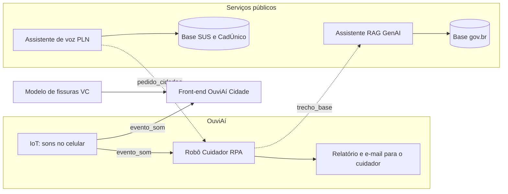

# Global Solution 2026.2 · CitizenTech

FIAP · Tecnólogo em Inteligência Artificial · turma 2TIAP

| Integrante | RM |
| --- | --- |
| Alexandre Ferreira | 565626 |
| Carlos Eduardo | 555812 |
| Filipe Melo | 564571 |

Este repositório reúne os itens desenvolvidos e entregues em cada disciplina da GS. A solução foi dividida por disciplina e acabou com dois temas: o **OuviAí**, que reconhece sons da casa para avisar uma pessoa com deficiência auditiva (IoT, RPA e Front-end, que também recebe pedidos de ajuda por escrito e usa o modelo de fissuras da Visão Computacional para fotos de calçada), e um assistente de **serviços públicos** por voz e texto (PLN e GenAI). A pasta [`governanca/`](governanca/) mostra o que foi e o que não foi integrado.

## Links

| Entrega | Link |
| --- | --- |
| Vídeo de Governança em IA e Business Analytics | **PREENCHER (YouTube, não listado)** |
| Relatório de Governança (ABNT/FIAP) | **PREENCHER** |
| Vídeo IoT (teste ao vivo) | https://youtube.com/shorts/_qvth7-RmWA |
| Vídeo PLN | https://youtu.be/Y7p-Rb2cKwg |
| Vídeo GenAI | https://youtu.be/BJQjDnIsgYk |
| Vídeo Visão Computacional | https://youtu.be/s6kzH4DmsZ8 |
| Vídeo Front-end | https://youtu.be/W1fvL07ybzc |
| Vídeo RPA | Não exigido pelo enunciado de RPA; evidências de execução, métricas e falha tratada em [`RPA/rpa-ouviai/exemplos_saida/`](RPA/rpa-ouviai/exemplos_saida/) |
| Deploy do Front-end | Docker: `docker compose up --build` em [`citizentech/`](citizentech/README.md#4-como-executar) |

## Disciplinas e pastas

| Disciplina | Pasta | O que está lá | Tema |
| --- | --- | --- | --- |
| Physical Computing (IoT) | [`iot-ouviai/`](iot-ouviai/) | Relatório do classificador de sons no Edge Impulse | OuviAí |
| AI for RPA | [`RPA/rpa-ouviai/`](RPA/rpa-ouviai/) | Robô Cuidador: código, testes, contrato de integração e exemplos de saída | OuviAí, consome os eventos do IoT |
| PLN | [`pln-assistente-voz/`](pln-assistente-voz/) | Relatório e link da entrega do assistente de voz | Serviços públicos (SUS e CadÚnico) |
| Generative AI | [`genai-rag/`](genai-rag/) | Notebook e documentação do assistente RAG | Serviços públicos (gov.br) |
| Front-end em Sistemas de IA | [`citizentech/`](citizentech/) | OuviAí Cidade: Streamlit + FastAPI + LLM, avisos da casa e pedidos de ajuda | OuviAí, recebe os eventos do IoT |
| Visão Computacional | [`visao-computacional/`](visao-computacional/) | Notebook e relatório do modelo de fissuras | Fotos de calçada no Front-end |
| Cluster Computing | [`cluster-ispd/`](cluster-ispd/) | Relatório da simulação no iSPD | Carga de inferência da solução |
| Computação Quântica | [`quantica/`](quantica/) | Análise sem código: gargalo, capacidade e roadmap | OuviAí |
| Governança em IA e BA | [`governanca/`](governanca/) | Quadro de integração, Model Cards, controles e termo de consentimento | Todos |

## Como os módulos trocam dados

O formato previsto para os dados entre os módulos está no [contrato de integração](RPA/rpa-ouviai/contrato_integracao_ouviai.json) (JSON Schema, versão 1.0.0). As linhas cheias existem; as tracejadas estão no contrato e não foram implementadas.



## Como executar

Cada pasta tem o seu README. O código executável (Front-end e RPA) sobe com Docker a partir da raiz, com o Docker Desktop aberto. Antes da primeira vez, copie `citizentech/.env.example` para `citizentech/.env` e preencha a `ANTHROPIC_API_KEY`.

```bash
docker compose up -d --build          # Front-end em http://localhost:8501 e relatórios do robô em http://localhost:8080
docker compose run --rm rpa           # Robô Cuidador do zero, com a semana de demonstração
docker compose run --rm rpa-de-novo   # segunda execução: não reindexa as fontes nem reenvia o e-mail
docker compose run --rm rpa-falhas    # entradas inválidas e o caminho seguro
docker compose run --rm testes        # pytest do Front-end, sem subir a interface
docker compose run --rm rpa-testes    # pytest do robô
docker compose down
```

- Front-end: [`citizentech/README.md`](citizentech/README.md).
- RPA: [`RPA/rpa-ouviai/README.md`](RPA/rpa-ouviai/README.md). Nenhuma chave é obrigatória; o `.env` do robô é opcional.
- GenAI e Visão Computacional: notebooks para o Google Colab nas pastas de cada disciplina, com as saídas salvas.
- IoT, PLN, Cluster e Computação Quântica: relatórios e vídeos nas pastas de cada disciplina.
